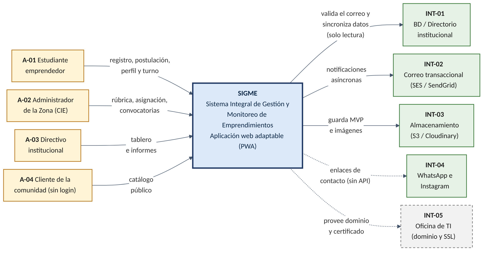
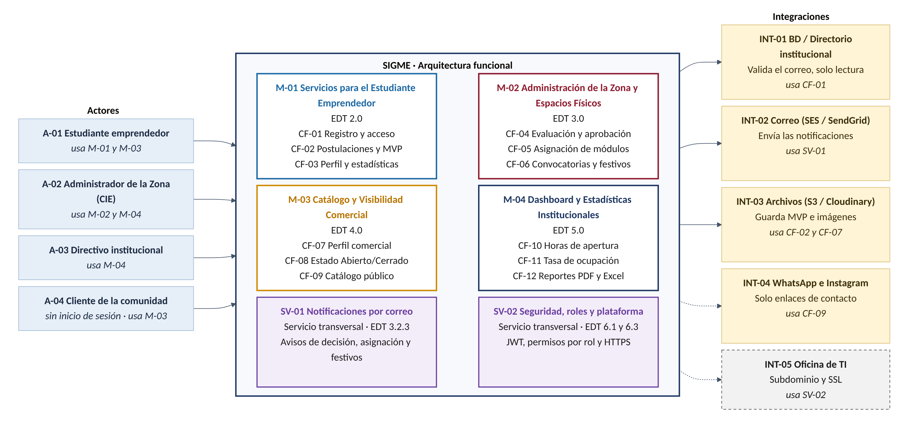
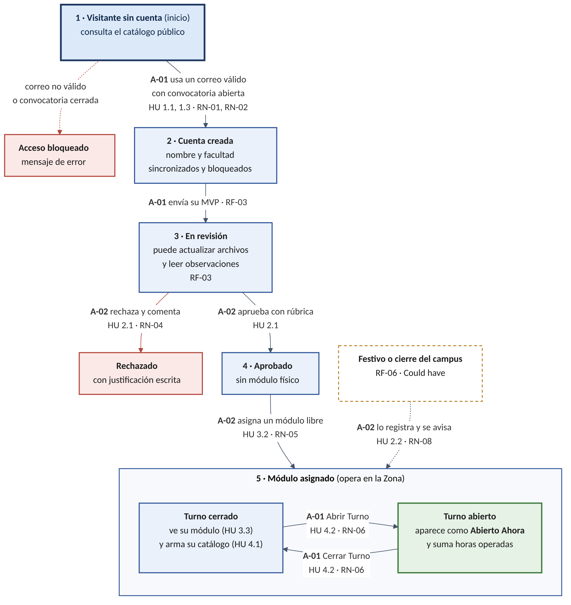
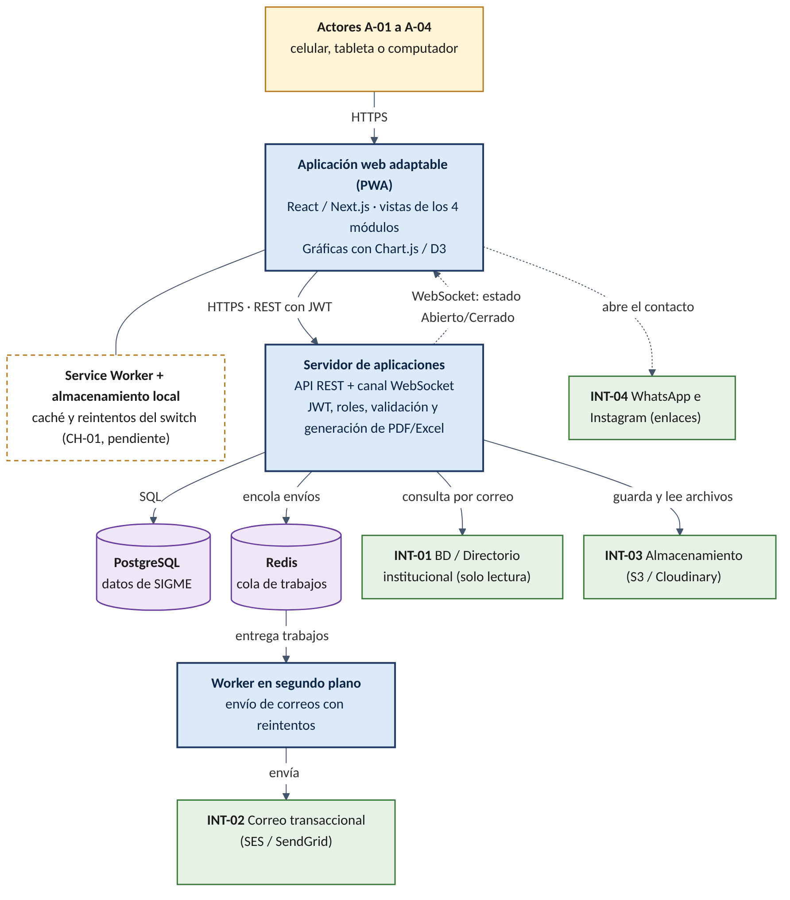
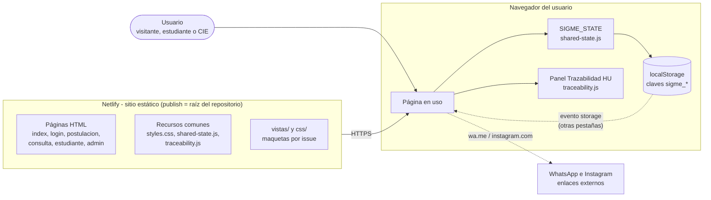
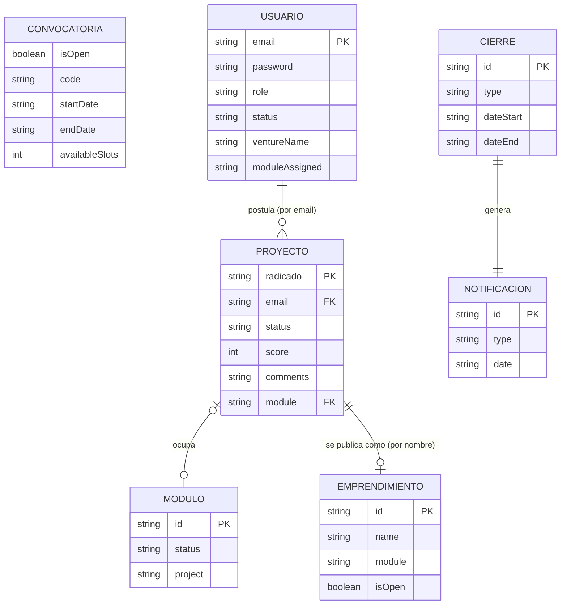
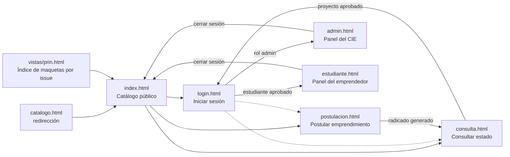
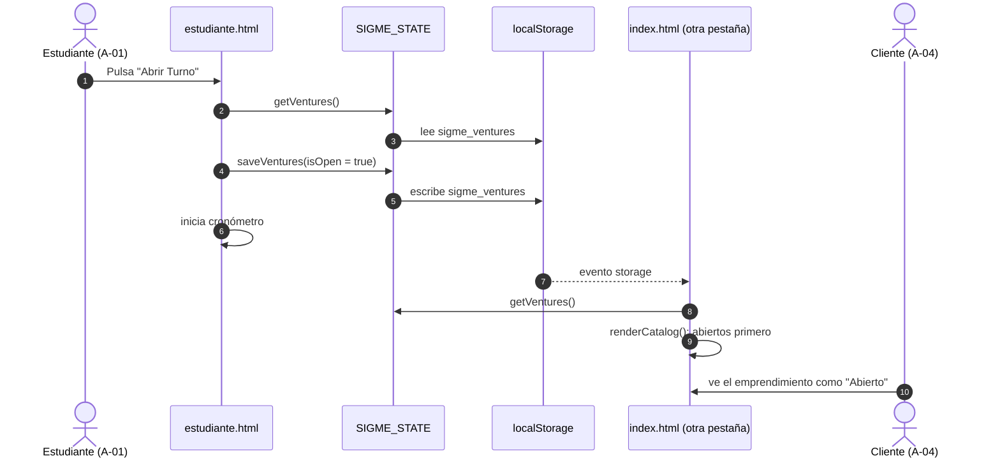

# Documentación de la Arquitectura de SIGME

**Sistema Integral de Gestión y Monitoreo de Emprendimientos (SIGME)**
Zona de Emprendimiento · Centro de Innovación y Emprendimiento (CIE) · Universidad del Magdalena

| Campo | Detalle |
|:--- |:--- |
| Documento | Documentación de la arquitectura |
| Versión | 1.0 |
| Fecha | 20/11/2026 |
| Equipo | Equipo SIGME |
| Fuente principal | Acta de Inicio v2.0 y Capítulo 12 del documento principal (Arquitectura funcional: módulos, actores e integraciones) |
| Prototipo publicado | https://funny-pegasus-abc158.netlify.app/ |

### Control de versiones

| Versión | Fecha | Autor(es) | Descripción del cambio |
|:--- |:--- |:--- |:--- |
| 1.0 | 20/11/2026 | Equipo SIGME | Versión inicial para la transición del producto |

---

## Contenido

1. [Introducción](#1-introducción)
2. [Contexto del sistema](#2-contexto-del-sistema)
3. [Arquitectura funcional](#3-arquitectura-funcional)
4. [Integraciones](#4-integraciones)
5. [Ciclo de vida y reglas de negocio](#5-ciclo-de-vida-y-reglas-de-negocio)
6. [Vista de contenedores y tecnologías](#6-vista-de-contenedores-y-tecnologías)
7. [Atributos de calidad y restricciones](#7-atributos-de-calidad-y-restricciones)
8. [Arquitectura del prototipo implementado](#8-arquitectura-del-prototipo-implementado)
9. [Correspondencia entre la arquitectura y el prototipo](#9-correspondencia-entre-la-arquitectura-y-el-prototipo)
10. [Decisiones de arquitectura](#10-decisiones-de-arquitectura)
11. [Decisiones pendientes](#11-decisiones-pendientes)
12. [Mantenimiento de esta documentación](#12-mantenimiento-de-esta-documentación)

---

## 1. Introducción

### 1.1 Propósito

Este documento describe la arquitectura de SIGME en dos niveles:

- **Arquitectura objetivo:** el sistema que se construirá en la fase de desarrollo. Las secciones 2 a 7 recogen el Capítulo 12 del documento principal, aprobado como línea base, y lo completan con la tabla de integraciones.
- **Arquitectura del prototipo:** lo que hoy existe en este repositorio, un prototipo navegable en HTML, CSS y JavaScript sin servidor ni base de datos. Las secciones 8 y 9 lo describen y lo relacionan con la arquitectura objetivo.

Cuando un dato difiere entre fuentes, prevalece el Acta de Inicio v2.0.

### 1.2 Documentos relacionados

| Documento | Ubicación |
|:--- |:--- |
| Acta de Inicio de Proyecto v2.0 | `doc/Acta de Inicio de Proyecto - SIGME.pdf` |
| Manual técnico y de operación | `doc/manual_tecnico_operacion.md` |
| Manual de usuario | `doc/manual_usuario.md` |
| Matriz de trazabilidad del prototipo | `trazabilidad_backlog.md` |
| Product Backlog | `backlog.pdf` y `.issues/open/` |
| Fuentes de los diagramas | `doc/diagramas/` |

### 1.3 Convenciones de identificadores

| Prefijo | Significado | Definido en |
|:--- |:--- |:--- |
| A-01 a A-04 | Actores | Este documento, sección 2 |
| M-01 a M-04 | Módulos funcionales (entregables de nivel 1 de la EDT) | Sección 3 |
| CF-01 a CF-12 | Componentes funcionales (entregables de nivel 2 de la EDT) | Sección 3 |
| SV-01, SV-02 | Servicios transversales | Sección 3 |
| INT-01 a INT-05 | Integraciones y dependencias externas | Sección 4 |
| RN-01 a RN-10 | Reglas de negocio | Sección 5 |
| AD-01 a AD-08 | Decisiones de arquitectura | Sección 10 |
| RF, RNF, HU, R, RS, P, CH | Requisitos funcionales y no funcionales, historias de usuario, restricciones, riesgos, premisas y cambios | Acta de Inicio v2.0 y backlog |

---

## 2. Contexto del sistema

### 2.1 Actores

SIGME tiene cuatro actores, tomados del registro de interesados del Acta v2.0. La Oficina de TI (proveedora de integraciones) y el equipo SIGME (constructor) no se consideran actores porque no operan el sistema.

| ID | Actor | Qué hace en el sistema | Acceso | Módulos |
|:--- |:--- |:--- |:--- |:--- |
| A-01 | Estudiante emprendedor | Se registra, postula su MVP, configura su perfil comercial y abre o cierra su turno | Autenticado | M-01, M-03 |
| A-02 | Administrador de la Zona (CIE) | Evalúa postulaciones, asigna módulos, configura convocatorias y festivos y consulta estadísticas | Autenticado, administrador | M-02, M-04 |
| A-03 | Directivo institucional | Consulta el dashboard y descarga informes | Autenticado, directivo | M-04 |
| A-04 | Cliente de la comunidad | Consulta el catálogo, ve qué emprendimientos están "Abierto Ahora" y los contacta por WhatsApp o Instagram | Sin inicio de sesión | M-03 |

### 2.2 Vista de contexto

La Figura 1 presenta SIGME como una sola caja, con los actores a la izquierda y los sistemas externos a la derecha. Las líneas continuas son integraciones funcionales (INT-01 a INT-04) y las punteadas, una dependencia de infraestructura sin intercambio de datos (INT-05).

**Figura 1. Diagrama de contexto de SIGME**



**Fuera del alcance (Acta v2.0, sección 4.3):** pagos en línea, inventarios y puntos de venta, registro de emprendedores externos sin vínculo académico, la red Wi-Fi del campus y las aplicaciones móviles nativas. El acceso desde celular se resuelve con la versión web adaptable.

---

## 3. Arquitectura funcional

Los cuatro módulos corresponden a los entregables de nivel 1 de la EDT (2.0 a 5.0) y los doce componentes, a los de nivel 2. Dos servicios transversales (SV-01 y SV-02) apoyan a todos los módulos. La Figura 2 se lee de izquierda a derecha: actores, módulos con sus componentes y servicios, e integraciones.

**Figura 2. Arquitectura funcional de SIGME: actores, módulos, componentes e integraciones**



Los entregables 1.0 (gestión del proyecto) y 6.0 (calidad, infraestructura y despliegue) no son módulos funcionales; el segundo se materializa en SV-02 y en las pruebas del paquete 6.2.

| ID | Elemento | EDT | Qué hace | Actores |
|:--- |:--- |:--- |:--- |:--- |
| **M-01** | **Servicios para el Estudiante Emprendedor** | 2.0 | Registro, postulación del MVP y seguimiento del desempeño | A-01 |
| CF-01 | Registro y acceso | 2.1 | Crea la cuenta con el correo institucional validado y gestiona el inicio de sesión | A-01, A-02, A-03 |
| CF-02 | Postulaciones y MVP | 2.2 | Recibe y actualiza los archivos del MVP y muestra estado, observaciones y módulo asignado | A-01 |
| CF-03 | Perfil y estadísticas personales | 2.3 | Muestra datos bloqueados, permite editar el contacto y presenta meses activos y horas operadas | A-01 |
| **M-02** | **Administración de la Zona y Espacios Físicos** | 3.0 | Evaluación de proyectos, asignación de espacios y reglas de convocatoria | A-02 |
| CF-04 | Evaluación y aprobación | 3.1 | Lista y filtra postulaciones, aplica la rúbrica y exige comentario al rechazar | A-02 |
| CF-05 | Asignación de módulos físicos | 3.2 | Muestra módulos libres y ocupados y vincula uno libre a un proyecto aprobado | A-02 |
| CF-06 | Convocatorias y festivos | 3.3 | Define apertura y cierre de convocatorias y registra festivos o cierres del campus | A-02 |
| **M-03** | **Catálogo y Visibilidad Comercial** | 4.0 | Convierte la operación del emprendimiento en visibilidad ante la comunidad | A-01, A-04 |
| CF-07 | Perfil comercial | 4.1 | Carga fotos, descripción y enlaces de WhatsApp e Instagram | A-01 |
| CF-08 | Estado Abierto/Cerrado en vivo | 4.2 | Alterna el turno, cuenta las horas y propaga el estado en tiempo real | A-01 |
| CF-09 | Catálogo público | 4.3 | Muestra sin inicio de sesión los emprendimientos, con los Abierto Ahora primero | A-01 a A-04 |
| **M-04** | **Dashboard y Estadísticas Institucionales** | 5.0 | Convierte horas de turno y asignaciones en indicadores | A-02, A-03 |
| CF-10 | Horas de apertura | 5.1 | Lista proyectos con horas acumuladas y nivel de riesgo | A-02, A-03 |
| CF-11 | Tasa de ocupación | 5.2 | Muestra el porcentaje de módulos ocupados | A-02, A-03 |
| CF-12 | Reportes PDF y Excel | 5.3 | Exporta el tablero a PDF o Excel | A-02, A-03 |
| SV-01 | Notificaciones por correo | 3.2.3 | Envía en segundo plano los avisos de decisión, asignación y festivos | Servicio |
| SV-02 | Seguridad, roles y plataforma | 6.1 y 6.3 | JWT, permisos por rol, HTTPS y tres entornos | Servicio |

Responsables por módulo según la EDT: M-01, Adrián Sebastián Botía; M-02, Rafael José Camargo; M-03, José Carlos Aguilar de la Hoz; M-04, Jean Carlos Delgado.

---

## 4. Integraciones

SIGME se conecta con cuatro sistemas externos y depende de la Oficina de TI para publicarse con HTTPS. Solo INT-01 trae datos de la Universidad y es de solo lectura (restricción R-04). Las notificaciones usan únicamente correo (SV-01): ninguna historia de usuario ni paquete de la EDT respalda el envío por WhatsApp.

| ID | Sistema externo | Para qué se integra | Lo usa | Gestiona | Condición y plan si falla |
|:--- |:--- |:--- |:--- |:--- |:--- |
| INT-01 | Base de datos de estudiantes de la Universidad (API o Sandbox de la Oficina de TI) | Valida el correo institucional y trae nombre y facultad, que quedan bloqueados. Solo lectura | CF-01 | Delgado (solicitud); Botía y Aguilar (integración) | Credenciales del Sandbox al iniciar la semana 1 (P-01). Si se demoran o el API falla (RS-01): Mock Server con datos de prueba |
| INT-02 | Correo transaccional (AWS SES o SendGrid) | Envía los avisos de decisión, módulo asignado y festivos desde una cola Redis y un worker, sin bloquear la aplicación | SV-01 | Camargo | Entrega en menos de 1 minuto (RNF-01). Si se satura la cola (RS-04): reintentos y pruebas de carga antes del Hito 3 |
| INT-03 | Almacenamiento en la nube (AWS S3 o Cloudinary) | Guarda los PDF e imágenes del MVP y las fotos del catálogo | CF-02, CF-07 | Botía | Servicio de pago disponible desde la semana 1 (P-05) |
| INT-04 | WhatsApp e Instagram | El estudiante registra sus enlaces y el catálogo los muestra. No se usa el API de estas redes | CF-09 (los carga CF-07) | Estudiante (A-01) | Sin dependencia técnica; el estudiante corrige sus enlaces desde su perfil |
| INT-05 | Oficina de TI (subdominio institucional y certificado SSL) | Publica SIGME con HTTPS (RNF-02). Dependencia de infraestructura, sin intercambio de datos | SV-02 | Aguilar | Antes de la UAT, el 30/11/2026 (P-04). Si el DNS se demora, la UAT se publica en un dominio temporal en la nube con SSL automático |

La elección entre AWS SES y SendGrid, y entre AWS S3 y Cloudinary, sigue abierta; la arquitectura funciona con cualquiera de las dos opciones.

---

## 5. Ciclo de vida y reglas de negocio

Un emprendimiento pasa por cinco estados, desde que alguien entra a SIGME hasta que opera en un módulo: visitante, cuenta creada, en revisión, aprobado (o rechazado) y módulo asignado con turno abierto o cerrado (Figura 3).

**Figura 3. Ciclo de vida de un emprendimiento en SIGME: estados, responsables y reglas de negocio**



Las flechas rojas indican bloqueo o rechazo; el recuadro verde, el estado Abierto Ahora; el festivo o cierre (línea punteada) es opcional (RF-06, Could have).

| ID | Regla de negocio | La aplica |
|:--- |:--- |:--- |
| RN-01 | Solo se registra un estudiante activo cuyo correo institucional exista en la base de la Universidad; de lo contrario se bloquea el acceso con un error | CF-01 |
| RN-02 | Las cuentas solo se crean dentro de las fechas de convocatoria; fuera de ellas se avisa que está cerrada | CF-01, CF-06 |
| RN-03 | Nombre y facultad vienen de la Universidad y no se editan; el estudiante solo edita sus datos de contacto | CF-03 |
| RN-04 | Al aprobar un proyecto se actualiza su estado y se notifica; al rechazarlo se exige un comentario que el estudiante puede leer | CF-02, CF-04, SV-01 |
| RN-05 | Solo un proyecto aprobado y sin módulo recibe uno libre, que pasa a Ocupado y se notifica por correo; un módulo ocupado no se asigna | CF-05, SV-01 |
| RN-06 | Con proyecto aprobado y módulo asignado, el estudiante arma su perfil comercial; Abrir Turno lo muestra como Abierto y Cerrar Turno detiene el conteo de horas | CF-07, CF-08 |
| RN-07 | El catálogo es público y muestra primero, con indicador visual, los emprendimientos Abierto Ahora | CF-09 |
| RN-08 | Al registrarse un festivo o cierre del campus, se avisa a los emprendimientos que ese día no habrá operación | CF-06, SV-01 |
| RN-09 | SIGME solo lee datos académicos de la Universidad; no guarda ni modifica datos sensibles | CF-01, CF-03 |
| RN-10 | El estudiante puede actualizar los archivos de su MVP mientras la postulación esté En revisión | CF-02 |

RN-03, RN-07, RN-09 y RN-10 no cambian el estado del emprendimiento y por eso no aparecen en la figura, pero deben cubrirse en las pruebas del paquete 6.2.1.

---

## 6. Vista de contenedores y tecnologías

La Figura 4 muestra las piezas que se despliegan (nivel 2 del modelo C4). Los cuatro actores usan una sola aplicación web adaptable (PWA) que se comunica por HTTPS con el servidor de aplicaciones. Este guarda los datos en PostgreSQL, encola los correos en Redis para que los procese un worker, consulta la base de la Universidad y almacena los archivos en un servicio externo. El estado Abierto/Cerrado llega al catálogo por WebSocket, sin recargar la página.

**Figura 4. Vista de contenedores de SIGME: aplicación web, API, worker, datos y sistemas externos**



El recuadro punteado (Service Worker y almacenamiento local) corresponde al cambio CH-01, pendiente de aprobación.

| Capa | Tecnología | Para qué se usa | Responsable |
|:--- |:--- |:--- |:--- |
| Aplicación web (PWA) | React/Next.js; diseño adaptable a celular, tableta y computador | Vistas de los cuatro módulos y del catálogo público | Botía, con Frontend Jr |
| Tiempo real y sin conexión | WebSockets; Service Worker, IndexedDB y reintentos (CH-01 pendiente) | Cambio de turno en vivo, sin perderlo si falla el Wi-Fi | Aguilar y Botía |
| Servidor de aplicaciones | API REST; JWT con expiración; validación en frontend y backend; permisos por rol | Reglas de negocio, seguridad y generación de PDF y Excel | Camargo, con Backend Jr |
| Datos | PostgreSQL en la nube, con índices combinados | Cuentas, postulaciones, módulos, turnos y horas | Camargo |
| Segundo plano | Redis (cola) y worker de correo; AWS SES o SendGrid | Enviar avisos sin bloquear la aplicación, con reintentos | Camargo, con Backend Jr |
| Archivos | AWS S3 o Cloudinary | PDF e imágenes | Botía |
| Estadísticas y reportes | Consultas SQL agregadas; Chart.js o D3.js; exportación a PDF y Excel | Tablero e informes institucionales | Delgado |
| Pruebas | Postman y JMeter | Pruebas de API y de carga (1.000 usuarios, RNF-01) | Analista QA, con Aguilar |
| Entrega continua | Git y GitHub Actions; entornos de desarrollo, pruebas y producción; alojamiento por definir (Render, Railway o AWS); HTTPS con subdominio institucional | Versionar, desplegar y publicar | Aguilar |

---

## 7. Atributos de calidad y restricciones

| Atributo o restricción | Requisito | Cómo lo atiende la arquitectura | Cómo se comprueba |
|:--- |:--- |:--- |:--- |
| Rendimiento | RNF-01: página en 3 s, CRUD en 500 ms, correo en menos de 1 minuto, 1.000 usuarios simultáneos | Cola Redis y worker (SV-01); índices combinados en PostgreSQL (RS-02); consultas agregadas; WebSocket | Pruebas de carga con Postman y JMeter (6.2.2); carga del correo antes del Hito 3 |
| Seguridad | RNF-02: HTTPS, JWT, expiración de sesión y defensa contra SQL Injection, XSS y CSRF | SV-02: HTTPS con certificado de TI (INT-05), JWT, validación en ambos extremos y permisos por rol | Configuración (6.1.2) y pruebas funcionales (6.2.1); verificación del SSL al salir a producción |
| Adaptabilidad | RNF-03: celular, tableta y computador; sin aplicaciones nativas | Una sola PWA adaptable (Figura 4) | Pruebas en celulares de prueba y UAT con el Patrocinador |
| Mantenibilidad | RNF-03: código modular en Git y tres entornos separados | Módulos alineados con la EDT y servicios transversales aparte (Figura 2) | Paquetes 6.3.1 y 6.3.2; definición de Terminado del equipo |
| Conectividad | R-03: el Wi-Fi del campus es de terceros (RS-05) | PWA con Service Worker, almacenamiento local y reintentos (CH-01, pendiente) | Si se aprueba CH-01: probar el cambio de turno sin señal |
| Datos académicos | R-04: no almacenar ni modificar datos sensibles | Conexión de solo lectura (INT-01); solo se copian nombre y facultad (RN-03 y RN-09) | Logs y pruebas de red del Hito 1, aprobados por el Product Owner y TI |
| Datos personales | Ley 1581 de 2012 (no figura en el Acta) | Limita lo que guarda (RN-09) y protege el acceso (SV-02) | Por confirmar con la Universidad: aviso de privacidad y autorización, antes de producción |

---

## 8. Arquitectura del prototipo implementado

### 8.1 Alcance y principios

El prototipo responde a la indicación del curso: vistas navegables en HTML y CSS, sin base de datos, con trazabilidad de cada pantalla a las historias del backlog. Para que los flujos se puedan recorrer de punta a punta se añadió una capa de estado en JavaScript que guarda datos de ejemplo en el `localStorage` del navegador. Sus principios son:

- **Sitio estático:** no hay servidor de aplicaciones, compilación ni dependencias externas. Netlify publica la raíz del repositorio tal cual.
- **Estado simulado en el navegador:** `shared-state.js` expone el objeto global `SIGME_STATE`, que hace las veces del API y de la base de datos. Cada navegador tiene su propia copia de los datos.
- **Trazabilidad visible:** `traceability.js` agrega a cada pantalla un panel que muestra la historia de usuario, la tarea de la EDT y el criterio de aceptación que atiende.
- **Dos niveles de vistas:** las pantallas integradas de la raíz forman el recorrido navegable; la carpeta `vistas/` contiene una maqueta por cada issue de interfaz del backlog.

### 8.2 Vista de despliegue y ejecución



**Figura 5. Despliegue y ejecución del prototipo**

Netlify entrega los archivos por HTTPS. Toda la lógica corre en el navegador: cada página lee y escribe el estado por medio de `SIGME_STATE`, y el catálogo (`index.html`) escucha el evento `storage` para actualizarse cuando otra pestaña del mismo navegador cambia los datos.

### 8.3 Elementos del prototipo

| Elemento | Responsabilidad |
|:--- |:--- |
| `index.html` | Catálogo público: tarjetas de emprendimientos con los abiertos primero, filtros, buscador, enlaces de contacto y banner de convocatoria |
| `login.html` | Inicio de sesión por rol, regla de acceso solo para proyectos aprobados y accesos a postulación y consulta |
| `postulacion.html` | Formulario de postulación en tres secciones, bloqueo si la convocatoria está cerrada y generación del radicado |
| `consulta.html` | Seguimiento por radicado o correo: línea de tiempo, observaciones, módulo asignado y gestión de archivos del MVP |
| `estudiante.html` | Panel del emprendedor: datos bloqueados, contacto editable, preferencias de aviso, avisos del CIE y turno con cronómetro |
| `admin.html` | Panel del CIE en cinco pestañas: postulaciones con rúbrica, módulos, convocatorias, disponibilidad y cierres, métricas y reportes |
| `catalogo.html` | Redirección a `index.html`, conservada por compatibilidad |
| `shared-state.js` | Datos iniciales de ejemplo y API de estado `SIGME_STATE` sobre `localStorage` |
| `traceability.js` | Panel "Trazabilidad HU" de cada pantalla, con su mapa de historias por página |
| `styles.css` | Hoja de estilos común: variables de color, tipografía y componentes |
| `vistas/`, `css/` | Una maqueta HTML y su hoja de estilos por cada issue de interfaz; índice en `vistas/prin.html` |
| `.issues/open/` | Issues del Product Backlog y sus comentarios de trazabilidad (`*.comment.md`) |
| `netlify.toml` | Configuración de publicación y encabezados de seguridad |

### 8.4 Modelo de datos simulado

Los datos viven en siete colecciones de `localStorage`. Las relaciones no se validan: se resuelven por correo electrónico (usuario y proyecto) o por nombre del emprendimiento (proyecto, módulo y catálogo). En la arquitectura objetivo estas colecciones pasan a ser tablas de PostgreSQL con claves foráneas.



**Figura 6. Modelo de datos simulado del prototipo (campos principales)**

El detalle de claves y campos está en el manual técnico y de operación, sección 9.

### 8.5 Mapa de navegación



**Figura 7. Mapa de navegación del prototipo**

El índice de maquetas `vistas/prin.html` no está enlazado desde las pantallas principales; se abre escribiendo su ruta.

### 8.6 Escenario de ejecución: abrir turno

El cambio de turno es el flujo que da valor comercial a SIGME. En el prototipo se propaga por `localStorage` y el evento `storage`; en la arquitectura objetivo lo hace un canal WebSocket (Figura 4).



**Figura 8. Escenario de apertura de turno en el prototipo**

La propagación solo ocurre entre pestañas del mismo navegador. Para que un cliente en otro dispositivo vea el cambio se requiere el servidor y el canal en tiempo real de la arquitectura objetivo.

---

## 9. Correspondencia entre la arquitectura y el prototipo

**Cobertura:** *Simulado* indica que la pantalla reproduce el comportamiento con datos de ejemplo; *Parcial*, que reproduce solo una parte; *Ilustrativo*, que muestra valores fijos; *No incluido*, que no tiene representación.

| Elemento | Dónde está en el prototipo | Cobertura | Observación |
|:--- |:--- |:--- |:--- |
| CF-01 Registro y acceso | `login.html` | Parcial | Inicio de sesión por rol con credenciales de ejemplo. No hay registro previo con validación contra la Universidad (RN-01, RN-02): la cuenta se crea al radicar la postulación |
| CF-02 Postulaciones y MVP | `postulacion.html`, `consulta.html` | Simulado | Radicado, línea de tiempo, observaciones y edición de archivos solo En revisión (RN-10). Los archivos se registran por nombre; no se cargan |
| CF-03 Perfil y estadísticas personales | `estudiante.html` | Parcial | Datos bloqueados y contacto editable (RN-03). Horas y turnos se muestran con valores fijos |
| CF-04 Evaluación y aprobación | `admin.html`, pestaña Postulaciones | Simulado | Rúbrica ponderada (30 %, 40 %, 30 %) y justificación obligatoria al aprobar y al rechazar |
| CF-05 Asignación de módulos físicos | `admin.html`, pestaña Infraestructura y Módulos | Simulado | Mapa E-01 a E-10, asignación y liberación. Añade el estado "mantenimiento" |
| CF-06 Convocatorias y festivos | `admin.html`, pestañas Apertura de Convocatorias y Disponibilidad y Cierres; `index.html`; `postulacion.html` | Simulado | Interruptor de convocatoria, parámetros de cohorte, registro de cierres y bloqueo del formulario |
| CF-07 Perfil comercial | `estudiante.html` | Parcial | Teléfono, WhatsApp, Instagram y descripción se reflejan en el catálogo. No hay carga de fotos |
| CF-08 Estado Abierto/Cerrado en vivo | `estudiante.html`, `index.html` | Parcial | Interruptor con cronómetro y propagación entre pestañas (Figura 8). Las horas del turno no se acumulan |
| CF-09 Catálogo público | `index.html` | Simulado | Abiertos primero con indicador visual (RN-07), filtros, buscador y enlaces de contacto |
| CF-10 Horas de apertura | `admin.html`, pestaña Métricas y Reportes | Ilustrativo | Tabla con valores fijos |
| CF-11 Tasa de ocupación | `admin.html`, pestaña Métricas y Reportes | Ilustrativo | Indicador con valor fijo |
| CF-12 Reportes PDF y Excel | `admin.html`; maquetas `vistas/32`, `vistas/35` y `vistas/36` | Parcial | PDF mediante la impresión del navegador. Sin exportación a Excel |
| SV-01 Notificaciones por correo | `estudiante.html` (bandeja de avisos); maqueta `vistas/19` | Simulado | Los avisos de cierre se registran en la bandeja del estudiante; no se envía correo |
| SV-02 Seguridad, roles y plataforma | `login.html`, `estudiante.html` | No incluido | Sin JWT ni validación en servidor; las credenciales de ejemplo están en el código. Netlify aporta HTTPS |
| INT-01 Base de datos de la Universidad | Datos bloqueados de ejemplo en `shared-state.js` | Simulado | Sin conexión real |
| INT-02 Correo transaccional | No aplica | No incluido | Ver SV-01 |
| INT-03 Almacenamiento de archivos | No aplica | No incluido | Ver CF-02 |
| INT-04 WhatsApp e Instagram | `index.html` (`wa.me` e `instagram.com`) | Igual a la arquitectura | Son enlaces, como en la arquitectura objetivo |
| INT-05 Subdominio y SSL | Subdominio de Netlify con HTTPS | Equivalente temporal | Coincide con el plan de contingencia de INT-05 (dominio temporal con SSL automático) |
| A-03 Directivo institucional | No tiene acceso propio | No incluido | Las métricas solo se ven desde el rol de administrador |

**Diferencias que deben resolverse antes del desarrollo:**

1. **Canal de notificación por WhatsApp.** El prototipo ofrece WhatsApp como canal de aviso (registro de cierres y preferencias del estudiante), mientras que la arquitectura define el correo como único canal (SV-01). Si el CIE lo quiere, debe tramitarse como solicitud de cambio, porque no tiene historia de usuario ni paquete en la EDT.
2. **Registro antes de postular.** La arquitectura exige crear la cuenta con el correo institucional validado (CF-01, RN-01 y RN-02) antes de postular; el prototipo permite postular sin cuenta. La implementación debe seguir la arquitectura.
3. **Acceso del directivo (A-03).** El sistema objetivo necesita un rol de solo consulta para el dashboard (M-04).

---

## 10. Decisiones de arquitectura

| ID | Decisión | Motivo | Consecuencia | Estado |
|:--- |:--- |:--- |:--- |:--- |
| AD-01 | Cuatro módulos funcionales, uno por entregable de nivel 1 de la EDT (2.0 a 5.0) | Un paquete, un responsable; trazabilidad directa con la EDT y el backlog | Cada módulo tiene un líder; los entregables 1.0 y 6.0 quedan como gestión y plataforma | Aprobada (Acta v2.0) |
| AD-02 | Una sola aplicación web adaptable (PWA) para los cuatro actores | El Acta excluye las aplicaciones nativas (RNF-03) | Un solo código cliente; el acceso móvil depende del navegador | Aprobada |
| AD-03 | Envío de correos en segundo plano con cola Redis y worker | Cumplir RNF-01 (correo en menos de 1 minuto) sin bloquear la aplicación (RS-04) | Se agrega Redis y un proceso worker con reintentos | Aprobada |
| AD-04 | Integración de solo lectura con la base de la Universidad | Restricción R-04 | Solo se copian nombre y facultad, bloqueados en el perfil (RN-03, RN-09) | Aprobada |
| AD-05 | Correo como único canal de notificación | Ninguna historia ni paquete respalda WhatsApp | El prototipo debe alinearse o tramitar un cambio (sección 9) | Aprobada |
| AD-06 | Estado Abierto/Cerrado por WebSocket | El catálogo debe reflejar el turno sin recargar (RN-07) | Requiere un canal persistente en el servidor | Aprobada |
| AD-07 | Caché sin conexión del cambio de turno (Service Worker e IndexedDB) | Mitigar la caída del Wi-Fi del campus (R-03, RS-05) | Sin duración ni presupuesto aprobados | Pendiente (CH-01) |
| AD-08 | Prototipo estático con estado en `localStorage` | La guía del curso pide vistas sin base de datos, pero los flujos deben poder recorrerse | Los datos son por navegador y se pierden al borrar el sitio; no sirve como base del código de producción | Aprobada para el prototipo |

---

## 11. Decisiones pendientes

| Tema | Opciones | Quién decide | Momento |
|:--- |:--- |:--- |:--- |
| Proveedor de correo (INT-02) | AWS SES o SendGrid | Líder Backend con el Gerente del Proyecto | Antes del sprint de notificaciones |
| Almacenamiento de archivos (INT-03) | AWS S3 o Cloudinary | Líder Frontend / Product Owner | Antes de implementar CF-02 |
| Alojamiento del sistema | Render, Railway o AWS, según cotización | Líder DevOps | Antes de crear el entorno de pruebas |
| Lenguaje y framework del servidor | No definido en el Acta ni en los capítulos de requisitos | Líderes técnicos (Acta, sección 13.2) | Antes del primer sprint de desarrollo |
| Caché sin conexión (CH-01) | Aprobar con duración y presupuesto, o rechazar | Patrocinador, por control de cambios | Antes de cerrar la línea base de M-03 |
| Tratamiento de datos personales | Aviso de privacidad y autorización (Ley 1581 de 2012) | Universidad, con el Patrocinador | Antes de la salida a producción |

---

## 12. Mantenimiento de esta documentación

- **Figuras 1 a 4.** La fuente de cada figura está en `doc/diagramas/` con el mismo nombre y extensión `.mmd`. Después de editar una fuente, se regenera su imagen con Mermaid CLI desde la raíz del repositorio:

  ```bash
  npx -p @mermaid-js/mermaid-cli mmdc -i doc/diagramas/02-arquitectura-funcional.mmd -o doc/diagramas/02-arquitectura-funcional.png -b white -s 2
  ```

- **Figuras 5 a 8.** Están escritas en Mermaid dentro de este archivo; GitHub las dibuja al mostrarlo, así que basta con editar el bloque de código.
- **Coherencia.** Todo cambio de módulos, componentes, integraciones o reglas debe reflejarse también en el Capítulo 12 del documento principal y en la tabla de correspondencia (sección 9). Si un cambio altera el alcance o la línea base, primero se tramita por control de cambios.
- **Versionado.** Cada cambio sustancial añade una fila al control de versiones del inicio de este documento.
